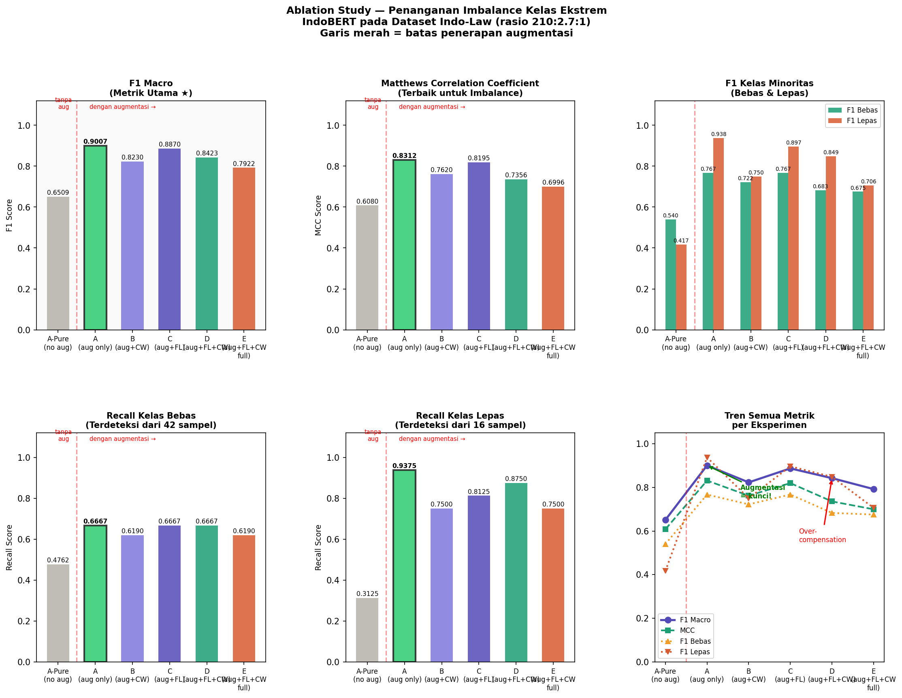
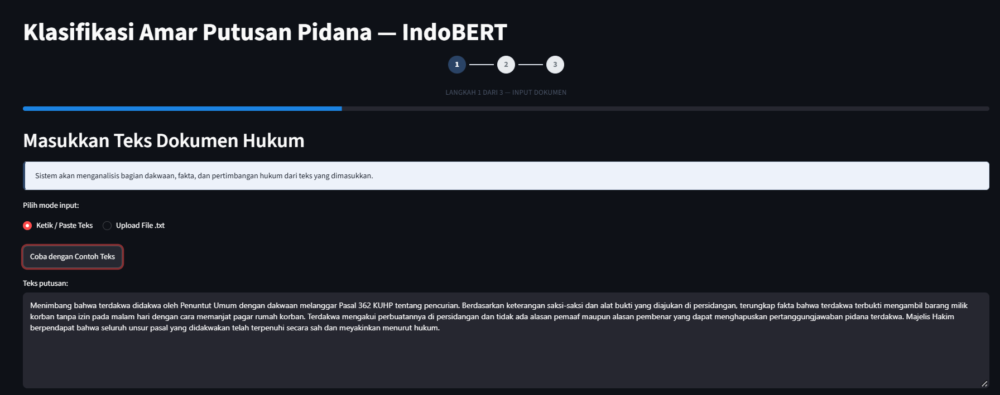
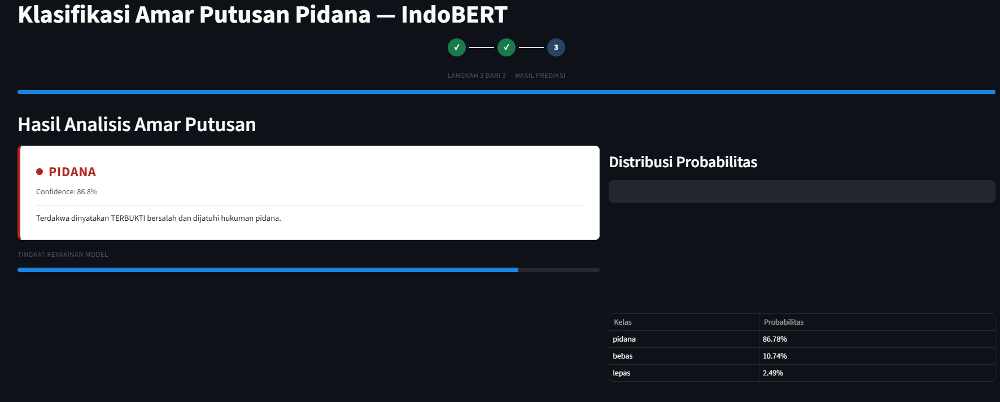

# Klasifikasi Amar Putusan Pidana Berbasis IndoBERT

Fine-tuning **IndoBERT** (`indolem/indobert-base-uncased`) untuk mengklasifikasikan amar putusan pengadilan Indonesia ke tiga kelas — **pidana**, **bebas**, **lepas** — pada data dengan ketidakseimbangan kelas ekstrem. Proyek ini memuat *ablation study* 6 eksperimen dan aplikasi web Streamlit.

> **Judul penelitian:** Augmentasi Teks sebagai Teknik Dominan dalam Penanganan Ketidakseimbangan Kelas Ekstrem pada Klasifikasi Amar Putusan Pidana Berbasis IndoBERT
> **Peneliti:** Aldo Spama Putra Suir (NIM 25.21.1593), S1 Informatika, Universitas AMIKOM Yogyakarta
> **Pembimbing:** Ferian Fauzi Abdulloh, M.Kom

## Temuan Utama

- Augmentasi teks pada data latih kelas minoritas **menaikkan F1 Macro dari 0,6509 menjadi 0,9007** (McNemar p = 0,00003).
- Menambahkan Focal Loss + Class Weighting di atas augmentasi **tidak membantu**, bahkan menurunkan performa secara signifikan (p = 0,0023 dan p = 0,0095).
- Model terbaik adalah **Exp A (augmentasi saja)**.

## Dataset dan Pra-pemrosesan

- Sumber: [`ir-nlp-csui/indo-law`](https://huggingface.co/datasets/ir-nlp-csui/indo-law).
- Input model: seksi `riwayat_dakwaan`, `fakta`, dan `pertimbangan_hukum`. Seksi `riwayat_tuntutan` **dikecualikan** karena berpotensi menimbulkan *label leakage*.
- Panjang maksimum 512 token dengan strategi *head + tail truncation* (128 token awal + 382 token akhir).
- Augmentasi (hanya data latih): *word deletion* 10%, *word swap*, dan *chunk shuffle*.
- Ukuran test set: **3.370 dokumen** (kelas bebas = 42, lepas = 16 pada test; sampel minoritas sangat kecil).

## Hasil Eksperimen

Seluruh angka di bawah disalin dari keluaran notebook pada test set (3.370 dokumen).

| Eksperimen | F1 Macro | MCC | Balanced Acc | F1 Bebas | F1 Lepas | Recall Bebas | Recall Lepas | PR-AUC Bebas | PR-AUC Lepas |
|---|---|---|---|---|---|---|---|---|---|
| Exp A-Pure (tanpa augmentasi) | 0,6509 | 0,6080 | 0,5956 | 0,5405 | 0,4167 | 0,4762 | 0,3125 | 0,5473 | 0,4165 |
| **Exp A (augmentasi saja)** | **0,9007** | **0,8312** | **0,8678** | **0,7671** | **0,9375** | 0,6667 | **0,9375** | 0,8181 | 0,9433 |
| Exp B | 0,8230 | 0,7620 | 0,7892 | 0,7222 | 0,7500 | 0,6190 | 0,7500 | 0,7743 | 0,893 |
| Exp C | 0,8870 | 0,8195 | 0,8262 | 0,7671 | 0,8966 | 0,6667 | 0,8125 | 0,8177 | 0,9233 |
| Exp D | 0,8423 | 0,7356 | 0,8458 | 0,6829 | 0,8485 | 0,6667 | 0,8750 | 0,7689 | 0,8871 |
| Exp E | 0,7922 | 0,6996 | 0,7884 | 0,6753 | 0,7059 | 0,6190 | 0,7500 | 0,7761 | 0,8627 |



### Uji Signifikansi McNemar (koreksi kontinuitas, α = 0,05)

| Perbandingan | b | c | χ² | p-value | Hasil |
|---|---|---|---|---|---|
| Exp A-Pure vs Exp A (dampak augmentasi) | 1 | 22 | 17,3913 | 0,000030 | Signifikan |
| Exp A vs Exp E | 18 | 3 | 9,3333 | 0,002250 | Signifikan |
| Exp B vs Exp C | 4 | 10 | 1,7857 | 0,181449 | Tidak signifikan |
| Exp A vs Exp D | 15 | 3 | 6,7222 | 0,009522 | Signifikan |

### Inferensi pada Seluruh Dataset

Model terbaik dijalankan pada 22.472 dokumen: akurasi 99,72% (22.410 benar, 96 salah). **Catatan:** angka ini mencakup data yang juga dipakai saat pelatihan, sehingga **bukan ukuran generalisasi**. Gunakan hasil test set di atas sebagai acuan performa.

## Aplikasi Streamlit

Aplikasi berbentuk *clean form wizard* tiga langkah: input dokumen, proses analisis, hasil prediksi.

| Step 1 — Input | | Step 2 — Hasil |
|---|---|---|
|  |  |

> Screenshot belum dimasukkan. Jalankan aplikasi, ambil tangkapan layar, lalu simpan dengan nama file di atas ke folder `docs/screenshots/`.

### Menjalankan

```bash
cd streamlit_app
pip install -r requirements.txt
streamlit run app.py
```

Struktur folder yang dibutuhkan:

```
streamlit_app/
├── app.py
├── requirements.txt
└── model_final/
    ├── model_state.pt
    ├── config_inferensi.json
    └── tokenizer/
```

## Reproduksi Eksperimen

1. Buka notebook `bert_imbalance_sinta2_final.ipynb` di Google Colab (GPU T4).
2. Jalankan sel secara berurutan; hasil dan model disimpan ke Google Drive (`bert-putusan-v3`).
3. Pelacakan eksperimen memakai MLflow (SQLite), experiment `bert-putusan-imbalance-study`.

## Keterbatasan

- Kelas minoritas pada test set sangat kecil (bebas = 42, lepas = 16), sehingga metrik per kelas memiliki ketidakpastian besar.
- Eksperimen dijalankan dengan satu *seed*; belum ada pengulangan untuk mengukur varians.
- Disclaimer: sistem hanya untuk referensi penelitian dan bukan pengganti putusan resmi.

## Sitasi

```
Suir, A. S. P. (2026). Augmentasi Teks sebagai Teknik Dominan dalam Penanganan
Ketidakseimbangan Kelas Ekstrem pada Klasifikasi Amar Putusan Pidana Berbasis IndoBERT.
Universitas AMIKOM Yogyakarta.
```
